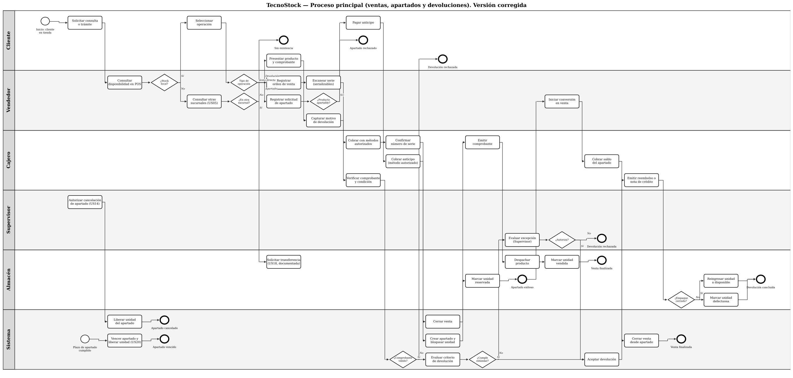

# Reporte — BPMN del proceso principal de TecnoStock (versión corregida)

| Nombre | Matrícula |
|---|---|
| Eduardo Alejandro Acevedo Liuskos | 2142139 |
| Emma Patricia Brown Sánchez | 2135479 |
| Diego Monroy García | 2135198 |

| Datos del curso | |
|---|---|
| Nombre del curso | Componentes de lógica de negocio |
| Nombre del profesor | Miguel Ángel Gómez Marroquín |
| Módulo Netacad | PIA (refina el Módulo 2) |
| Actividad | PIA — BPMN corregido (versión corregida de U2) |
| Fecha | 06/11/2026 |

## Bibliografía (formato APA)

- Documento de caso asignado enviado por el docente. (2026). Caso 05: TecnoStock, retail de electrónica.
- Gómez Marroquín, M. Á. (2026). Producto Integrador de Aprendizaje: Implementación de una solución de software basada en lógica de negocio [Documento del curso Componentes de lógica de negocio].
- BRD, User Stories, BPMN y Glosario de dominio de TecnoStock, versión de la Unidad 2 (07/09/2026) y diagramas y ADR de la Unidad 3.

## Objetivo

Modelar el proceso principal de TecnoStock (ventas, apartados y devoluciones) en un BPMN con carriles, decisiones, eventos y excepciones, alineado con el BRD, las historias, el glosario y los diagramas.

## Procedimiento

Se tomó el BPMN de la Unidad 2 y se contrastó con las historias y los diagramas de la Unidad 3. Se corrigieron los carriles donde contradecía a las historias y se agregaron los flujos que faltaban (cobro de anticipo, vencimiento, cancelación y condición del producto). El diagrama se dibujó con un script; el archivo fuente y el PNG de tamaño completo están en docs/analisis/bpmn/. Cada cambio está en el Registro de cambios.

## 1. Diagrama

El PNG completo (bpmn_proceso_principal.png) se ve mejor ampliado; aquí se incluye reducido para consulta.

## 2. Carriles

| Carril | Participa en |
|---|---|
| Cliente | Solicita la consulta o el trámite, selecciona la operación, paga el anticipo y presenta producto y comprobante. |
| Vendedor | Consulta disponibilidad local y en otras sucursales, registra la orden de venta o la solicitud de apartado, escanea la serie, captura el motivo de devolución e inicia la conversión de un apartado. |
| Cajero | Cobra con métodos autorizados, confirma la serie, cobra anticipo y saldo, emite comprobantes, verifica comprobante y condición del producto y emite reembolso o nota de crédito. |
| Supervisor | Autoriza la cancelación de un apartado y evalúa las devoluciones que incumplen el criterio estándar. |
| Almacén | Solicita transferencias, marca unidades reservadas o vendidas, despacha, y reingresa o marca como defectuosas las unidades devueltas. |
| Sistema (nuevo) | Cierra la venta, crea el apartado y bloquea la unidad, vence apartados, valida el comprobante y evalúa el criterio de devolución. |

## 3. Cambios respecto al BPMN de la Unidad 2

| Cambio | BPMN de U2 | BPMN corregido | Motivo | Registro |
|---|---|---|---|---|
| Serie | El Vendedor escanea la serie y no hay confirmación. | El Vendedor la escanea al armar la orden y el Cajero la confirma al cobrar. | US09 y RN-VTA-001 asignan la captura de cierre al Cajero. | C-02 |
| Transferencia | El Vendedor solicita la transferencia. | Almacén la solicita; el Vendedor solo consulta otras sucursales. | US18 la asigna a Almacén. | C-03 |
| Política de devolución | La decisión «¿Cumple política estándar?» está en el carril del Supervisor para toda devolución. | El Sistema evalúa el criterio; el Supervisor solo evalúa las excepciones. | US10, US13, BRD y diagramas de U3. | C-04 |
| Cobro de anticipo | El Cliente paga el anticipo y Almacén reserva. | El Cajero cobra el anticipo con método autorizado y el Sistema crea el apartado antes de que Almacén marque la reserva. | US11 y RN-VTA-002. | C-05 |
| Producto apartable | No existe la decisión. | Se agrega «¿Producto apartable?» antes del anticipo. | RN-APT-004. | C-08 |
| Vencimiento y cancelación | No aparecen. | Evento «Plazo de apartado cumplido» y cancelación autorizada por el Supervisor. | US20 y US14. | C-05 |
| Comprobante de devolución | El comprobante se verifica sin decisión de rechazo. | Comprobante inválido termina en rechazo definitivo. | RN-DEV-001 y diagrama 05. | C-04 |
| Condición del producto | Solo «estado físico». | El Cajero verifica la condición (empaque cerrado, abierto o defectuoso). | RN-DEV-003. | C-09 |
| Compensación y destino de la unidad | «Reembolso o nota de crédito» y «Reingresar a stock o merma». | Compensación por reembolso o nota de crédito; la unidad vuelve a disponible solo con empaque cerrado, en otro caso queda defectuosa. | RN-DEV-004 y RN-INV-004. | C-10, C-11 |
| Venta y transferencia | — | La transferencia (US18) y la conciliación (US15) se mantienen en el modelo como documentadas, sin implementar. | Alcance del PIA (BRD 4.3). | C-05 |
