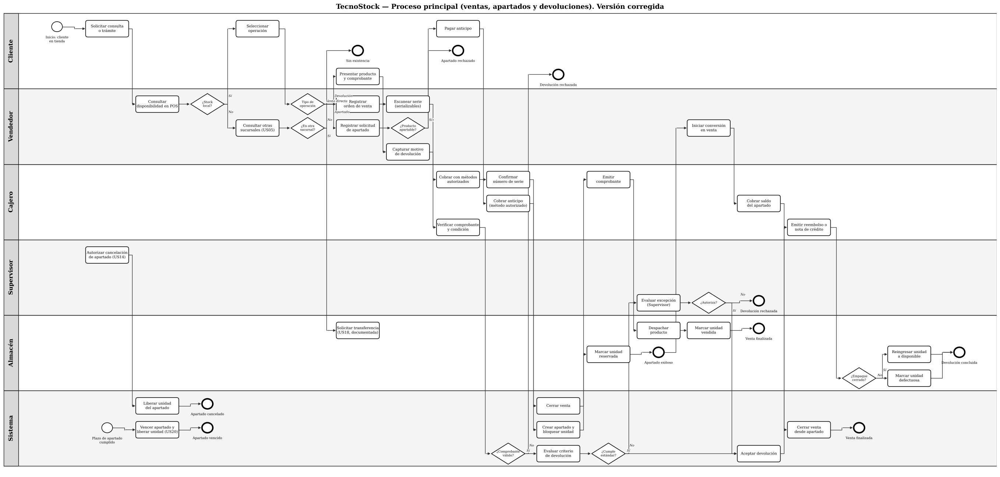
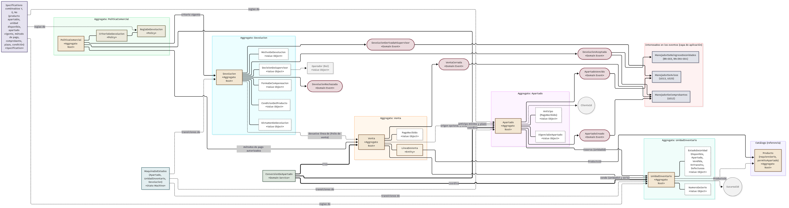
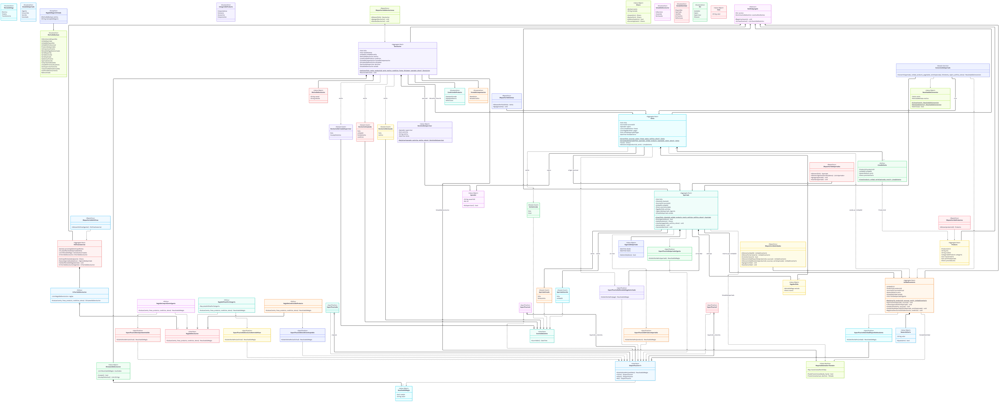
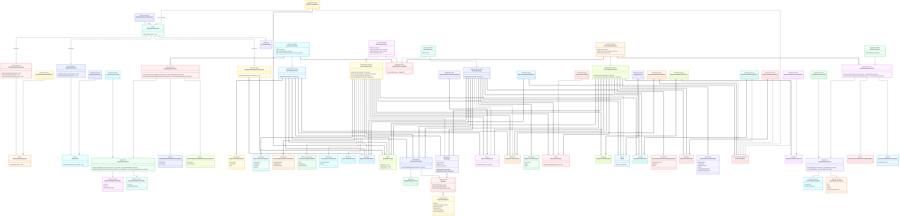
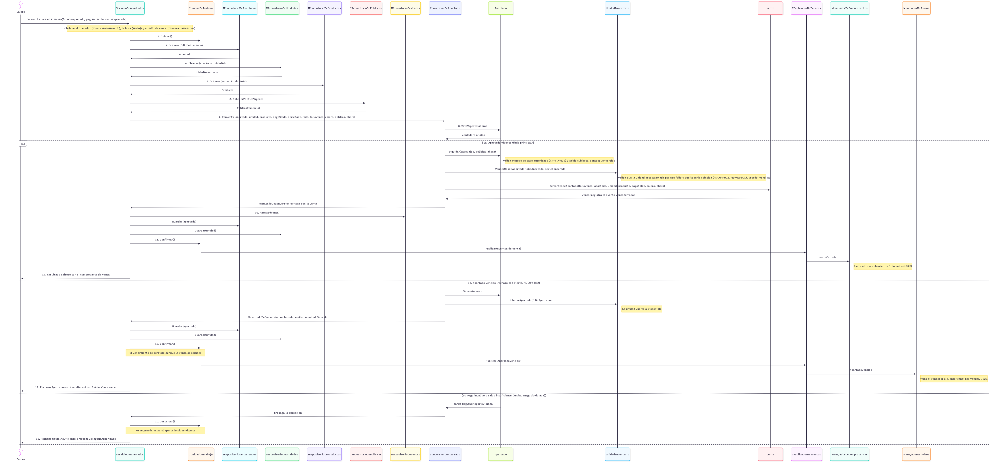
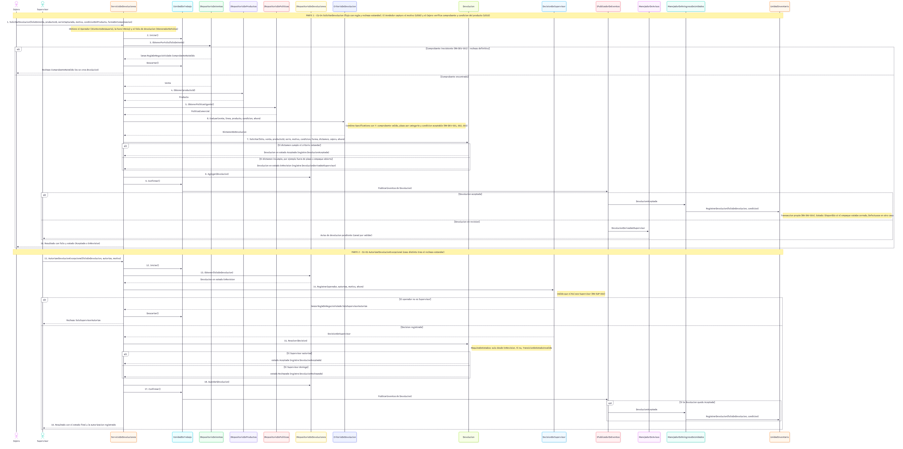
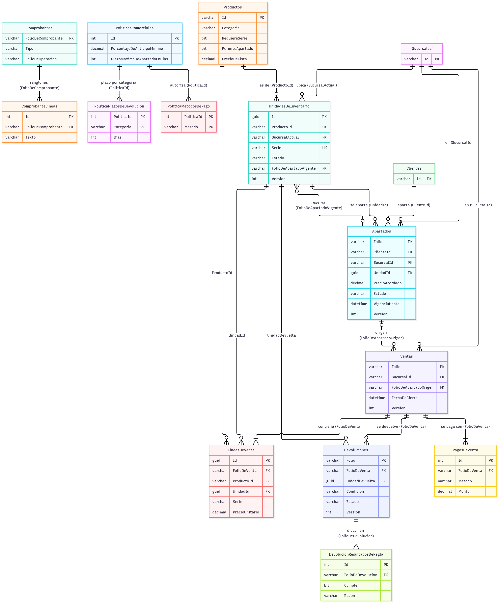
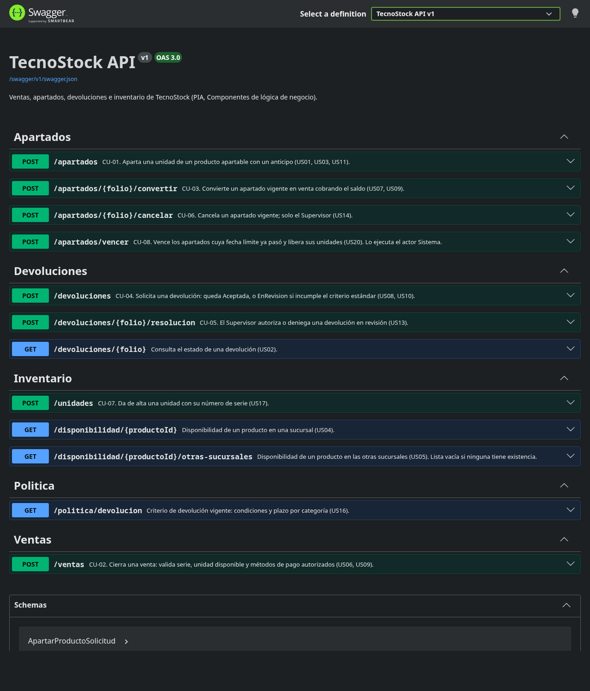

# Reporte final — Sistema de ventas, apartados, devoluciones e inventario de TecnoStock

| Nombre | Matrícula |
|---|---|
| Eduardo Alejandro Acevedo Liuskos | 2142139 |
| Emma Patricia Brown Sánchez | 2135479 |
| Diego Monroy García | 2135198 |

| Datos del curso | |
|---|---|
| Nombre del curso | Componentes de lógica de negocio |
| Nombre del profesor | Miguel Ángel Gómez Marroquín |
| Módulo Netacad | PIA |
| Actividad | PIA — Reporte final (BRD, arquitectura, evidencias y conclusiones) |
| Fecha | 06/11/2026 |

## Bibliografía (formato APA)

- Documento de caso asignado enviado por el docente. (2026). Caso 05: TecnoStock, retail de electrónica.
- Gómez Marroquín, M. Á. (2026). Producto Integrador de Aprendizaje: Implementación de una solución de software basada en lógica de negocio [Documento del curso Componentes de lógica de negocio].
- Evans, E. (2003). Domain-driven design: Tackling complexity in the heart of software. Addison-Wesley.
- Fowler, M. (2002). Patterns of enterprise application architecture. Addison-Wesley.
- Nygard, M. (2011, 15 de noviembre). Documenting architecture decisions. Cognitect. https://www.cognitect.com/blog/2011/11/15/documenting-architecture-decisions
- Microsoft. (2026). Entity Framework Core documentation. Microsoft Learn. https://learn.microsoft.com/ef/core/
- Render. (2026). Render documentation: Blueprint specification, persistent disks, free instances and web services. https://render.com/docs
- BRD, User Stories, BPMN y Glosario de dominio de TecnoStock, versión de la Unidad 2 (07/09/2026) y diagramas y ADR de la Unidad 3.

## Objetivo

Presentar el sistema de TecnoStock desarrollado como Producto Integrador de Aprendizaje: los requerimientos de negocio (BRD), el análisis, la arquitectura y el diseño, la implementación con .NET 10 y SQL Server, las evidencias de calidad (pruebas, cobertura, contenedores, integración continua y despliegue) y las conclusiones, con la trazabilidad entre cada necesidad del negocio y su prueba automática.

## Procedimiento

Se partió de los documentos de las Unidades 2 y 3, que se contrastaron entre sí y se corrigieron (registro de cambios C-01 a C-41). Sobre esa base se implementó el dominio con Domain-Driven Design, después la capa de aplicación, la persistencia en SQL Server y la API REST, y por último la infraestructura de contenedores, la integración continua y el despliegue. Cada fase terminó con la compilación y las pruebas en verde y con un commit; el repositorio tiene más de 40 commits en español. Las cifras de este reporte provienen de ejecuciones reales realizadas el 06/11/2026 y se indican con su fuente. Lo que el caso no define se marca como **[Supuesto]**.

## Contenido

1. Resumen ejecutivo
2. Análisis de negocio (BRD)
3. Historias de usuario y criterios de aceptación
4. Proceso de negocio (BPMN)
5. Arquitectura
6. Modelo de datos
7. Implementación
8. Pruebas, calidad y evidencias
9. Despliegue
10. Decisiones, supuestos y registro de cambios
11. Cumplimiento de los criterios del PIA
12. Conclusiones y trabajo futuro
13. Anexo A: Glosario de dominio
14. Anexo B: Trazabilidad de escenarios y pruebas

## 1. Resumen ejecutivo

TecnoStock es una cadena de retail de electrónica con cinco sucursales. Su operación presentaba descuadres entre el inventario físico y el del sistema, ventas accidentales de productos apartados, pérdida de la trazabilidad de los números de serie y criterios de devolución inconsistentes. El sistema construido ataca esos cuatro problemas con reglas de negocio que viven en el dominio y no en los controladores ni en la base de datos.

**Qué se construyó.** Una solución .NET 10 con cuatro proyectos (dominio, aplicación, infraestructura y API) y dos de pruebas. Implementa 8 casos de uso (apartar un producto, registrar una venta, convertir un apartado en venta, solicitar una devolución, autorizar una devolución excepcional, cancelar un apartado, registrar una unidad y vencer apartados) y 4 consultas, expuestos en 12 endpoints REST documentados con OpenAPI y Swagger. Los datos se guardan en SQL Server con Entity Framework Core en un esquema normalizado de 15 tablas y 18 claves foráneas.

**Alcance.** Se implementan las necesidades BR-001 a BR-006 (historias US01 a US14, la consulta de US16, US17 y US20). Las transferencias entre sucursales (BR-007, US18 y US19) y la conciliación de inventario (BR-008, US15) forman parte del negocio y están documentadas, pero no se implementan.

**Cifras de la última verificación.**

| Indicador | Resultado | Fuente |
|---|---|---|
| Pruebas automáticas | 236 en verde (175 unitarias y 61 de integración contra SQL Server) | `dotnet test` y Docker Compose, 06/11/2026 |
| Cobertura de líneas | 98.7% local y 98.1% dentro de Docker (exigido: 80%) | `scripts/pruebas-con-cobertura.sh` |
| Escenarios Gherkin con prueba | 41 de 41 implementados (44 en total, 3 documentados) | `TrazabilidadPruebas` |
| Tiempo de respuesta de la disponibilidad | mediana 6.7 ms y p95 8.4 ms (objetivo CE-05: 3 s) | medición local, 200 peticiones |
| Código | 3,006 líneas de C# en `src` y 3,263 en `tests` | repositorio |

**Lo que falta.** La presentación de apoyo, la demostración en vivo y la dirección pública del sistema desplegado: el despliegue en Render está definido y probado localmente, pero requiere crear la cuenta y aplicar el Blueprint (sección 9).

## 2. Análisis de negocio (BRD)

Esta sección reproduce el BRD vigente (`docs/BRD.md`) sin la portada. Las necesidades BR-001 a BR-008 y las reglas RN-* son la base de las historias, del dominio y de las pruebas.

**2.2.1 Contexto y objetivos de negocio**

TecnoStock es una cadena de cinco sucursales de retail de electrónica (computadoras, celulares, accesorios y componentes). Vende en sucursal y permite apartados de ciertos productos. El estado actual (AS-IS) presenta descuadres entre inventario físico y de sistema, venta accidental de productos apartados, pérdida de trazabilidad de números de serie y criterios de devolución inconsistentes. El estado futuro (TO-BE) busca una operación controlada, trazable y auditable en las cinco sucursales.


**2.1.1 Objetivos estratégicos**

- OE-1. Eliminar la discrepancia entre inventario físico y de sistema.
- OE-2. Impedir la venta de productos con apartado vigente mediante el bloqueo íntegro de la unidad reservada.
- OE-3. Garantizar la trazabilidad completa de las unidades serializadas.
- OE-4. Estandarizar los criterios objetivos de devolución y la autorización del Supervisor.


**2.2.2 Problema y oportunidad**

| Problema detectado                                   | Causa raíz probable                                    | Oportunidad de mejora                                                                       | Necesidad |
| ---------------------------------------------------- | ------------------------------------------------------ | ------------------------------------------------------------------------------------------- | --------- |
| El inventario del sistema no coincide con el físico. | Falta de conciliación periódica y ajustes sin control. | Reglas de conciliación (RN-INV) y autorización de ajustes (RN-SUP).                         | BR-008    |
| Venta accidental de productos apartados.             | Ausencia de bloqueo íntegro de la unidad reservada.    | Bloqueo de la unidad apartada (RN-APT-003).                                                 | BR-004    |
| Dificultad para rastrear números de serie.           | La captura de serie no es obligatoria ni validada.     | Validación obligatoria de la serie al cerrar la venta (RN-VTA-001) y unicidad (RN-INV-002). | BR-003    |
| Devoluciones aplicadas de forma inconsistente.       | No existe una política objetiva de devolución.         | Catálogo formal de condiciones de devolución (RN-DEV).                                      | BR-005    |


**2.2.3 Stakeholders, roles y gobernanza**

Los cinco roles los asignó el profesor y no se modifican. Para eliminar la ambigüedad entre Vendedor y Cajero, esta versión define una frontera explícita (cambio C-01): el **Vendedor atiende antes del cobro** y el **Cajero maneja el dinero y el cierre**.

| Rol        | Responsabilidad principal                                                                                                                                                                                                  | Autoridad clave                                                                                                          |
| ---------- | -------------------------------------------------------------------------------------------------------------------------------------------------------------------------------------------------------------------------- | ------------------------------------------------------------------------------------------------------------------------ |
| Cliente    | Selecciona productos, solicita apartados y devoluciones.                                                                                                                                                                   | Ninguna autoridad de sistema.                                                                                            |
| Vendedor   | Consulta disponibilidad (local y otras sucursales), arma la orden de venta o la solicitud de apartado, escanea la serie al armar la orden, captura el motivo de devolución e inicia la conversión de un apartado en venta. | No cobra, no autoriza excepciones ni descuentos.                                                                         |
| Cajero     | Cobra anticipos y saldos, valida el método de pago, confirma la serie al cerrar la venta, valida el comprobante y la condición física del producto en una devolución y emite comprobantes y reembolsos o notas de crédito. | No modifica precios ni políticas.                                                                                        |
| Supervisor | Resuelve escalaciones y controla excepciones.                                                                                                                                                                              | Único autorizado para descuentos extraordinarios, cancelaciones, ajustes de inventario y devoluciones fuera de política. |
| Almacén    | Resguarda, despacha, recibe y transfiere mercancía; da de alta unidades con su serie; solicita transferencias entre sucursales.                                                                                            | Reporta discrepancias; no ajusta inventario sin autorización.                                                            |
| Sistema    | Ejecuta de forma automática la evaluación de la política de devolución y el vencimiento de apartados.                                                                                                                      | Solo aplica reglas ya definidas.                                                                                         |


**2.2.4 Alcance**


**2.4.1 Dentro del alcance**

- Venta en sucursal, apartados, devoluciones y transferencias entre las 5 sucursales.
- Trazabilidad de número de serie y conciliación de inventario físico contra sistema.
- Niveles de autorización del rol Supervisor sobre las operaciones anteriores.


**2.4.2 Fuera del alcance**

- Comercio electrónico (web o app), nómina y finanzas corporativas avanzadas.
- Compras a proveedores, marketing y fidelización, apertura de nuevas sucursales.


**2.4.3 Alcance de la implementación del PIA**

Las necesidades BR-001 a BR-006 se implementan en el sistema. BR-007 (transferencias) y BR-008 (conciliación) forman parte del alcance del negocio y están documentadas con sus historias (US15, US18, US19), pero **no se implementan en el PIA**; el diseño las contempla mediante el estado EnTransito de la unidad. Las historias US01 a US14, US16 (consulta), US17 y US20 sí se implementan.


**2.2.5 Necesidades y requerimientos de negocio**

| ID     | Título                          | Descripción                                                                                  | Prioridad | Historias                                |
| ------ | ------------------------------- | -------------------------------------------------------------------------------------------- | --------- | ---------------------------------------- |
| BR-001 | Disponibilidad multi-sucursal   | Consultar la existencia de un producto en las 5 sucursales en tiempo de atención.            | Alta      | US04, US05                               |
| BR-002 | Venta con pago autorizado       | Restringir el cobro a métodos de pago formalmente autorizados.                               | Alta      | US11, US12                               |
| BR-003 | Trazabilidad de número de serie | Registrar la unidad física exacta entregada en venta, transferencia o devolución.            | Alta      | US09, US17, US19                         |
| BR-004 | Gestión de apartados            | Reservar una unidad de un producto apartable mediante anticipo, con vigencia y bloqueo.      | Alta      | US01, US03, US06, US07, US11, US14, US20 |
| BR-005 | Gestión de devoluciones         | Validar comprobante, plazo, condición del producto y causal antes de aceptar una devolución. | Alta      | US02, US08, US10, US16                   |
| BR-006 | Autorización de excepciones     | Requerir validación del Supervisor en operaciones sensibles.                                 | Alta      | US13, US14                               |
| BR-007 | Transferencias entre sucursales | Trasladar mercancía con visibilidad de estado (origen, tránsito, destino).                   | Media     | US18, US19                               |
| BR-008 | Conciliación de inventario      | Comparar periódicamente la existencia física contra el sistema.                              | Alta      | US15                                     |


**2.2.6 Catálogo de reglas de negocio**

Las reglas con **[Supuesto]** no estaban definidas en el caso; se derivan de una necesidad, del glosario o del BPMN y quedan pendientes de validar con el stakeholder.

| ID         | Tipo         | Declaración formal                                                                                                                                                                      | Disparador                            | Origen                                                                             |
| ---------- | ------------ | --------------------------------------------------------------------------------------------------------------------------------------------------------------------------------------- | ------------------------------------- | ---------------------------------------------------------------------------------- |
| RN-VTA-001 | Restricción  | Todo producto serializable requiere número de serie registrado antes de cerrar la venta.                                                                                                | Cierre de venta.                      | U2                                                                                 |
| RN-VTA-002 | Restricción  | Solo se aceptan métodos de pago autorizados por la política vigente.                                                                                                                    | Captura del pago.                     | U2                                                                                 |
| RN-APT-001 | Restricción  | Todo apartado exige un anticipo mínimo según la política comercial.                                                                                                                     | Registro de apartado.                 | U2 [Supuesto]                                                                      |
| RN-APT-002 | Restricción  | El apartado tiene un plazo máximo de vigencia; vencido sin liquidar cambia a «Vencido» y libera la unidad.                                                                              | Cumplimiento del plazo.               | U2 [Supuesto]                                                                      |
| RN-APT-003 | Restricción  | La unidad apartada queda bloqueada para venta a terceros mientras el apartado esté vigente.                                                                                             | Registro exitoso del apartado.        | U2                                                                                 |
| RN-APT-004 | Restricción  | Solo los productos marcados como apartables pueden apartarse.                                                                                                                           | Registro de apartado.                 | Nueva (C-08) [Supuesto]. Caso: «algunos artículos pueden apartarse».               |
| RN-INV-001 | Disparador   | Debe realizarse una conciliación periódica de inventario físico contra sistema.                                                                                                         | Cumplimiento del periodo.             | U2                                                                                 |
| RN-INV-002 | Restricción  | Cada número de serie corresponde a una única unidad activa; se prohíbe la duplicidad.                                                                                                   | Registro o recepción de unidad.       | U2                                                                                 |
| RN-INV-003 | Disparador   | La mercancía transferida queda «en tránsito» hasta la confirmación en destino.                                                                                                          | Envío de transferencia.               | U2                                                                                 |
| RN-INV-004 | Restricción  | Una unidad con devolución aceptada vuelve a «Disponible» solo si se devolvió con empaque cerrado; en otro caso pasa a «Defectuosa» y se retira de la venta.                             | Devolución aceptada.                  | Nueva (C-11) [Supuesto]. Glosario G-12 y G-13; BPMN «Reingresar a stock / merma».  |
| RN-DEV-001 | Restricción  | Toda devolución requiere un comprobante de compra válido. Sin comprobante válido la solicitud se rechaza de forma definitiva.                                                           | Solicitud de devolución.              | U2                                                                                 |
| RN-DEV-002 | Restricción  | La devolución procede dentro de un plazo máximo desde la compra, según la categoría del producto.                                                                                       | Solicitud de devolución.              | U2                                                                                 |
| RN-DEV-003 | Restricción  | El Cajero registra la condición del producto (empaque cerrado, empaque abierto o defectuoso). La devolución estándar acepta empaque cerrado o defectuoso; empaque abierto es excepción. | Solicitud de devolución.              | Nueva (C-09) [Supuesto]. BR-005; glosario G-09 y G-10.                             |
| RN-DEV-004 | Restricción  | Toda devolución aceptada se compensa con reembolso o con nota de crédito.                                                                                                               | Devolución aceptada.                  | Nueva (C-10) [Supuesto]. Glosario G-11; BPMN «Emitir reembolso / nota de crédito». |
| RN-SUP-001 | Autorización | Descuentos fuera de política, cancelaciones y ajustes de inventario requieren autorización del Supervisor.                                                                              | Operación fuera de política estándar. | U2                                                                                 |
| RN-SUP-002 | Autorización | Las devoluciones fuera de política solo proceden con autorización documentada del Supervisor.                                                                                           | Incumplimiento de criterio estándar.  | U2                                                                                 |


**2.2.7 Supuestos, parámetros y restricciones**


**2.7.1 Parámetros de la política comercial**

El BRD de U2 solo daba rangos. Para poder implementar y probar se fijan los valores siguientes. Todos son configurables en la política comercial y deben validarse con el stakeholder (cambio C-07).

| Parámetro                                     | Valor propuesto                   | Rango del BRD de U2          | Estado     |
| --------------------------------------------- | --------------------------------- | ---------------------------- | ---------- |
| Anticipo mínimo de apartado                   | 30% del precio acordado           | 20% a 30%                    | [Supuesto] |
| Vigencia máxima de apartado                   | 7 días naturales                  | 7 días naturales             | [Supuesto] |
| Plazo de devolución, Computadoras y Celulares | 15 días naturales                 | 15 a 30 días según categoría | [Supuesto] |
| Plazo de devolución, Accesorios y Componentes | 30 días naturales                 | 15 a 30 días según categoría | [Supuesto] |
| Métodos de pago autorizados                   | Efectivo, Tarjeta y Transferencia | Sin catálogo                 | [Supuesto] |
| Periodicidad de conciliación                  | Mensual                           | Mensual                      | [Supuesto] |
| Productos con número de serie                 | Laptop, Monitor y SSD             | Sin lista                    | [Supuesto] |
| Productos apartables                          | Laptop, Monitor y SSD             | «Ciertos productos»          | [Supuesto] |


**2.7.2 Restricciones del negocio**

- Operación limitada a las 5 sucursales físicas existentes; sin canal digital al cliente final.
- Toda excepción a la política estándar requiere intervención documentada del Supervisor.
- Este documento define lógica de negocio, no arquitectura tecnológica.
- Los importes se manejan en pesos mexicanos (MXN).


**2.7.3 Supuestos pendientes de validar**

- El canal de notificación de vencimientos y de devoluciones en revisión (US13 y US20) no está definido.
- Un cambio de producto se resuelve emitiendo una nota de crédito; aplicar la nota de crédito como método de pago queda fuera del alcance.
- Los precios y el catálogo de la implementación provienen de los datos de ejemplo del curso y no representan precios reales.


**2.2.8 Criterios de éxito medibles**

Las metas numéricas son **[Supuesto]** y se validarán con el stakeholder (cambio C-06).

| ID    | Criterio                                                                     | Medición                                                                    | Objetivo           | Se verifica con                        |
| ----- | ---------------------------------------------------------------------------- | --------------------------------------------------------------------------- | ------------------ | -------------------------------------- |
| CE-01 | Ninguna venta de una unidad con apartado vigente.                            | Ventas de unidades en estado Apartada ajenas a su apartado.                 | 0                  | US06; prueba de rechazo UnidadApartada |
| CE-02 | Toda venta de un producto serializable lleva serie registrada y única.       | Ventas serializables sin serie o con serie duplicada.                       | 0                  | US09, US17                             |
| CE-03 | Los descuadres de inventario se detectan en la conciliación mensual.         | Conciliaciones realizadas por mes.                                          | 1 por sucursal     | US15 (documentada)                     |
| CE-04 | Toda devolución fuera de política tiene decisión documentada del Supervisor. | Devoluciones aceptadas fuera de política sin decisión registrada.           | 0                  | US13                                   |
| CE-05 | La disponibilidad se consulta en las 5 sucursales durante la atención.       | Tiempo de respuesta de la consulta.                                         | 3 segundos o menos | US04, US05                             |
| CE-06 | Los apartados vencidos liberan su unidad.                                    | Apartados vencidos con unidad aún bloqueada tras el proceso de vencimiento. | 0                  | US20                                   |
| CE-07 | Toda operación genera un comprobante con folio único.                        | Operaciones sin comprobante o con folio repetido.                           | 0                  | US12                                   |


### 2.9 Estado de los criterios de éxito

| ID | Criterio | Estado | Evidencia |
|---|---|---|---|
| CE-01 | Ninguna venta de una unidad con apartado vigente | Verificado | `US06_Vender_una_unidad_apartada_responde_409_UnidadApartada`; la prueba de carrera `RN_APT_003_Dos_apartados_simultaneos_de_la_misma_unidad_solo_dejan_uno_vigente` confirma que la base impide dos apartados vigentes sobre una unidad |
| CE-02 | Toda venta serializable lleva serie registrada y única | Verificado | Pruebas de US09 y US17; índice único `IX_Unidades_Serie` |
| CE-03 | Descuadres detectados en la conciliación mensual | No implementado | US15 está documentada |
| CE-04 | Toda devolución fuera de política tiene decisión del Supervisor | Verificado | Pruebas de US13; la decisión se guarda en columnas `Decision…` |
| CE-05 | Disponibilidad en 3 segundos o menos | Verificado | Mediana 6.7 ms y p95 8.4 ms en 200 peticiones locales; un solo cliente, catálogo de 20 productos y 517 unidades |
| CE-06 | Los apartados vencidos liberan su unidad | Verificado | `US20_Vencer_libera_las_unidades_de_los_apartados_vencidos_y_no_toca_los_vigentes` |
| CE-07 | Toda operación genera un comprobante con folio único | Verificado | Manejador de comprobantes, clave primaria de `Comprobantes` y pruebas de US12 |

## 3. Historias de usuario y criterios de aceptación

Se documentaron 20 historias (el mínimo exigido es 15) con 44 escenarios en Gherkin que cubren el flujo normal y los rechazos. Son la base de las pruebas: cada escenario implementado tiene al menos una prueba automática (Anexo B).

| ID | Rol | Historia | Prior. | Necesidad y reglas | Alcance en el PIA |
|---|---|---|---|---|---|
| US01 | Cliente | Como Cliente, quiero apartar un producto pagando un anticipo, para asegurar que nadie más lo compre mientras reúno el pago completo. | Alta | BR-004; RN-APT-001, RN-APT-003, RN-APT-004 | Implementada (CU-01) |
| US02 | Cliente | Como Cliente, quiero conocer el estado de mi devolución, para saber si procede el reembolso o la nota de crédito, o si fue rechazada. | Media | BR-005; RN-DEV-004 | Implementada (consulta) |
| US03 | Cliente | Como Cliente, quiero recibir confirmación de mi apartado con su fecha límite, para saber cuánto tiempo tengo para completar el pago. | Media | BR-004; RN-APT-002 | Implementada (CU-01) |
| US04 | Vendedor | Como Vendedor, quiero consultar la disponibilidad de un producto en mi sucursal en tiempo real, para informar correctamente al cliente. | Alta | BR-001 | Implementada (consulta) |
| US05 | Vendedor | Como Vendedor, quiero consultar la disponibilidad de un producto en otras sucursales, para ofrecer alternativas cuando no hay stock local. | Alta | BR-001 | Implementada (consulta) |
| US06 | Vendedor | Como Vendedor, quiero que el sistema impida vender un producto que está apartado y vigente, para evitar ventas accidentales sobre stock comprometido. | Alta | BR-004; RN-APT-003 | Implementada (CU-02) |
| US07 | Vendedor | Como Vendedor, quiero iniciar la conversión de un apartado vigente en venta cuando el cliente va a liquidar el saldo, para que el Cajero complete la operación sin perder el anticipo. | Alta | BR-004; RN-APT-002, RN-VTA-001, RN-VTA-002 | Implementada (CU-03) |
| US08 | Vendedor | Como Vendedor, quiero registrar el motivo de una devolución, para que el negocio pueda dar seguimiento a problemas recurrentes de producto. | Media | BR-005 | Implementada (CU-04) |
| US09 | Cajero | Como Cajero, quiero confirmar el número de serie exacto que el Vendedor registró al armar la orden, para dejar en cada comprobante la unidad física que salió. | Alta | BR-003; RN-VTA-001 | Implementada (CU-02, CU-03) |
| US10 | Cajero | Como Cajero, quiero validar el comprobante, el plazo y la condición del producto antes de procesar una devolución, para asegurar que corresponde a una venta real y vigente. | Alta | BR-005; RN-DEV-001, RN-DEV-002, RN-DEV-003 | Implementada (CU-04) |
| US11 | Cajero | Como Cajero, quiero recibir el pago del anticipo al crear un apartado, para formalizar la reserva del producto. | Alta | BR-002, BR-004; RN-VTA-002, RN-APT-001 | Implementada (CU-01) |
| US12 | Cajero | Como Cajero, quiero que cada operación genere un comprobante con folio único, para dejar respaldo verificable de la transacción. | Alta | BR-002; CE-07 | Implementada (manejador de eventos) |
| US13 | Supervisor | Como Supervisor, quiero autorizar o denegar una devolución que no cumple las condiciones estándar, para resolver casos excepcionales sin violar la política general. | Alta | BR-006; RN-SUP-002 | Implementada (CU-05) |
| US14 | Supervisor | Como Supervisor, quiero cancelar manualmente un apartado antes de su vencimiento, para atender solicitudes especiales del cliente. | Media | BR-004, BR-006; RN-SUP-001 | Implementada (CU-06) |
| US15 | Supervisor | Como Supervisor, quiero generar un reporte de descuadres entre el inventario del sistema y el físico, para identificar y corregir diferencias. | Alta | BR-008; RN-INV-001 | Documentada (fuera de la implementación) |
| US16 | Supervisor | Como Supervisor, quiero definir y consultar el criterio vigente de devoluciones, para que se aplique de manera uniforme entre sucursales. | Alta | BR-005; RN-DEV-002 | Parcial: consulta implementada; la definición se hace por configuración sembrada |
| US17 | Almacén | Como Almacén, quiero registrar el número de serie al dar de alta una unidad recibida, para rastrearla durante todo su ciclo de vida. | Alta | BR-003; RN-INV-002 | Implementada (CU-07) |
| US18 | Almacén | Como Almacén, quiero solicitar la transferencia de un producto desde otra sucursal, para cubrir una venta o apartado sin existencia local. | Alta | BR-007; RN-INV-003 | Documentada (fuera de la implementación) |
| US19 | Almacén | Como Almacén, quiero confirmar la recepción de una unidad transferida desde otra sucursal, para actualizar su ubicación en el inventario. | Alta | BR-007; RN-INV-003 | Documentada (fuera de la implementación) |
| US20 | Sistema | Como Sistema, quiero liberar automáticamente un apartado que vence sin completarse el pago, para que el producto vuelva a estar disponible. | Alta | BR-004; RN-APT-002; CE-06 | Implementada (CU-08) |

Ejemplo de criterios de aceptación (US01, apartar un producto):

```
Escenario: Creación de un apartado
    Given que el producto es apartable y tiene una unidad disponible en la sucursal
    When el cliente solicita apartarla y el Cajero registra un anticipo igual o mayor al mínimo de la política
    Then el sistema reserva esa unidad y la excluye del inventario disponible para venta

Escenario: Anticipo insuficiente
    Given que el producto es apartable y tiene una unidad disponible
    When el anticipo es menor al porcentaje mínimo de la política
    Then el sistema rechaza el apartado con el motivo AnticipoInsuficiente y la unidad sigue disponible
```

## 4. Proceso de negocio (BPMN)

El BPMN modela el proceso principal (ventas, apartados y devoluciones) con seis carriles, decisiones, eventos y excepciones. Se corrigió respecto de la Unidad 2 (cambios C-02 a C-05, C-08 a C-11), por ejemplo para que el Sistema, y no el Supervisor, evalúe el criterio de devolución.



| Carril | Participa en |
|---|---|
| Cliente | Solicita la consulta o el trámite, selecciona la operación, paga el anticipo y presenta producto y comprobante. |
| Vendedor | Consulta disponibilidad local y en otras sucursales, registra la orden de venta o la solicitud de apartado, escanea la serie, captura el motivo de devolución e inicia la conversión de un apartado. |
| Cajero | Cobra con métodos autorizados, confirma la serie, cobra anticipo y saldo, emite comprobantes, verifica comprobante y condición del producto y emite reembolso o nota de crédito. |
| Supervisor | Autoriza la cancelación de un apartado y evalúa las devoluciones que incumplen el criterio estándar. |
| Almacén | Solicita transferencias, marca unidades reservadas o vendidas, despacha, y reingresa o marca como defectuosas las unidades devueltas. |
| Sistema (nuevo) | Cierra la venta, crea el apartado y bloquea la unidad, vence apartados, valida el comprobante y evalúa el criterio de devolución. |

## 5. Arquitectura

### 5.1 Estilo y capas

La solución sigue Domain-Driven Design (Evans, 2003) con arquitectura en capas. El dominio no depende de nada: ni de Entity Framework, ni de ASP.NET, ni de SQL. Las reglas de negocio viven en los aggregates, los Value Objects, las Specifications y las máquinas de estados.

| Proyecto | Responsabilidad | Depende de |
|---|---|---|
| `TecnoStock.Dominio` | Aggregates, Value Objects, eventos, Specification, máquina de estados, interfaces de repositorio | nada |
| `TecnoStock.Aplicacion` | Servicios de aplicación, commands y queries, puertos, manejadores de eventos | dominio |
| `TecnoStock.Infraestructura` | EF Core y SQL Server, repositorios, Unidad de Trabajo, publicador de eventos, folios, lectores | aplicación y dominio |
| `TecnoStock.Api` | Controllers REST, traducción de rechazos a HTTP, Swagger | aplicación, dominio e infraestructura (solo para ensamblar las dependencias) |

### 5.2 Modelo de dominio

El dominio tiene seis aggregates, que se refieren entre sí solo por identidad: Apartado, UnidadInventario, Venta (con su entidad LineaDeVenta), Devolucion, PoliticaComercial y Producto. Hay 6 eventos de dominio, un servicio de dominio (ConversionDeApartado) y un modelo de rechazo con 18 motivos.







### 5.3 Secuencias principales

La secuencia de la conversión de un apartado en venta muestra los tres desenlaces de ADR-006: éxito, rechazo con efecto (el apartado vencido se guarda) y violación de regla con reversión.





### 5.4 Componentes obligatorios del PIA

**Specification (ADR-007).** Cada regla es una especificación que explica por qué falla y se combina con Y, O y No. Hay siete: producto apartable, unidad disponible para venta, apartado vigente, método de pago autorizado, comprobante válido, devolución dentro de plazo y condición aceptable.

```
public interface IEspecificacion<T>
{
    ResultadoDeRegla EsSatisfechaPor(T candidato);

    IEspecificacion<T> Y(IEspecificacion<T> otra) => new EspecificacionY<T>(this, otra);
    IEspecificacion<T> O(IEspecificacion<T> otra) => new EspecificacionO<T>(this, otra);
    IEspecificacion<T> No() => new EspecificacionNo<T>(this);
}
```

**Máquina de estados (ADR-008).** Una máquina genérica con la tabla de transiciones de cada aggregate. Una transición no permitida lanza `ReglaDeNegocioViolada` con el motivo `TransicionDeEstadoInvalida`. Ejemplo, el ciclo de vida de un apartado:

```
public static readonly MaquinaDeEstados<EstadoDeApartado> Apartado = new(
        new Dictionary<EstadoDeApartado, EstadoDeApartado[]>
        {
            [EstadoDeApartado.Vigente] = [EstadoDeApartado.Convertido, EstadoDeApartado.Vencido, EstadoDeApartado.Cancelado],
            [EstadoDeApartado.Convertido] = [],
            [EstadoDeApartado.Vencido] = [],
            [EstadoDeApartado.Cancelado] = []
        });
```

**Tres tipos de rechazo (ADR-006).** Una violación de regla revierte la transacción; una devolución que incumple el criterio estándar no se rechaza sino que queda `EnRevision` y se deriva al Supervisor; y el vencimiento de un apartado se guarda aunque la conversión se rechace. El servicio de dominio que convierte un apartado en venta valida todo antes de modificar nada, de modo que un rechazo nunca deja cambios parciales:

```
public ResultadoDeConversion Convertir(Apartado apartado, UnidadInventario unidad, Producto producto,
        PagoRecibido pagoSaldo, NumeroDeSerie? serieCapturada, Folio folioVenta, Operador cajero,
        PoliticaComercial politica, DateTime ahora)
    {
        if (!apartado.EstaVigente(ahora))
        {
            // Vencer lanza TransicionDeEstadoInvalida si el apartado ya estaba Convertido o Cancelado.
            apartado.Vencer(ahora);
            unidad.LiberarApartado(apartado.Folio);
            return ResultadoDeConversion.Rechazada(MotivoDeRechazo.ApartadoVencido);
        }

        // Se valida todo antes de modificar nada: si algo falla se lanza la excepción sin dejar cambios parciales.
        apartado.ValidarLiquidacion(pagoSaldo, politica);
        unidad.ValidarVentaDesdeApartado(apartado.Folio, serieCapturada);
        var venta = Venta.CerrarDesdeApartado(folioVenta, apartado, unidad, producto, pagoSaldo, cajero, ahora);

        apartado.Liquidar(pagoSaldo, politica, ahora);
        unidad.VenderDesdeApartado(apartado.Folio, serieCapturada);
        return ResultadoDeConversion.Exitosa(venta);
    }
```

**Unidad de Trabajo y eventos (ADR-003).** Cada caso de uso es una transacción. Si la acción regresa se confirma (incluido el rechazo con efecto); si lanza una violación de regla se descarta y se traduce a un rechazo; los eventos de dominio se publican después de confirmar y atienden comprobantes, reingreso de unidades y avisos.

```
protected Resultado EjecutarEnUnidadDeTrabajo(Func<Resultado> accion)
    {
        unidadDeTrabajo.Iniciar();
        try
        {
            var resultado = accion();
            unidadDeTrabajo.Confirmar();
            return resultado;
        }
        catch (ReglaDeNegocioViolada violacion)
        {
            unidadDeTrabajo.Descartar();
            return Resultado.Rechazar(traductor.Traducir(violacion));
        }
        catch
        {
            unidadDeTrabajo.Descartar();
            throw;
        }
    }
```

### 5.5 Decisiones de arquitectura

Se registraron diez ADR (Nygard, 2011): contexto, alternativas, decisión, consecuencias y trazabilidad.

| ADR | Decisión | Consecuencia principal |
|---|---|---|
| ADR-001 | Domain Model para los comandos y Transaction Script para las lecturas; Table Module descartado | Las reglas viven en un solo lugar y se prueban sin infraestructura; a cambio hay más clases y mapeo |
| ADR-002 | Aggregates separados que se refieren por identidad; UnidadInventario es raíz propia con versión | Menos contención y trazabilidad por unidad; la serie única se garantiza con un índice único |
| ADR-003 | Service Layer con una Unidad de Trabajo por caso de uso y eventos después de confirmar | Consistencia fuerte donde importa y desacoplamiento donde no; consistencia eventual en el reingreso de unidades |
| ADR-004 | CQRS básico sin base separada; el manejador es el método del servicio | Lecturas simples y escritura protegida; dos caminos que mantener alineados |
| ADR-005 | Políticas parametrizables y reglas de devolución como estrategias intercambiables | El Supervisor puede cambiar valores y se agregan reglas sin editar código existente |
| ADR-006 | Tres tipos de rechazo: excepción de dominio, resultado con derivación y rechazo con efecto | Errores en términos del negocio; hay que distinguir los tres tipos al crear reglas |
| ADR-007 | Specification con Y, O y No | Reglas reutilizables, combinables y con explicación del incumplimiento |
| ADR-008 | Máquina de estados genérica para Apartado, UnidadInventario y Devolucion | Transiciones válidas en un solo lugar y fáciles de probar |
| ADR-009 | EF Core con SQL Server, Unidad de Trabajo transaccional, índice único de serie y concurrencia por versión | Persistencia real sin que el dominio dependa de EF Core; más memoria en Docker y en el despliegue |
| ADR-010 | Claves de negocio de texto y esquema relacional normalizado con claves foráneas | La base impide registros huérfanos; el esquema cambió con respecto a la primera versión |

### 5.6 Principios SOLID en el código

- **Responsabilidad única:** cada aggregate protege sus propias invariantes y los servicios de aplicación solo coordinan; las reglas no están en los controladores.
- **Abierto/cerrado:** una regla nueva de devolución es una clase nueva que implementa `ReglaDeDevolucion`, sin editar las existentes (ADR-005).
- **Sustitución de Liskov:** las composiciones `Y`, `O` y `No` son especificaciones y se usan donde se espera cualquier `IEspecificacion<T>`.
- **Segregación de interfaces:** puertos pequeños y específicos (reloj, generador de folios, contexto de usuario, publicador, lectores).
- **Inversión de dependencias:** el dominio y la aplicación definen las interfaces; la infraestructura las implementa. Las pruebas de aplicación usan repositorios en memoria y las de integración, SQL Server real, con el mismo código.

## 6. Modelo de datos

El esquema se creó con Entity Framework Core sobre SQL Server y se revisó con respecto a las formas normales (ADR-010). Las claves de negocio son de texto porque el tipo de una clave no afecta la normalización y porque son identificadores que el negocio usa (`TEC-P001`, `APT-000001`, `SUC-01`); donde no hay código humano, la clave es un GUID. Los códigos se guardan como `varchar`.



| Aspecto | Decisión |
|---|---|
| Integridad referencial | 18 claves foráneas, sin borrado en cascada y sin propiedades de navegación en el dominio |
| Primera forma normal | Ninguna columna guarda listas o JSON: los métodos de pago, los plazos de devolución, el dictamen y los renglones del comprobante son tablas hijas, y la decisión del Supervisor son columnas (0 columnas `nvarchar(max)`) |
| Serie única (RN-INV-002) | Índice único `IX_Unidades_Serie` |
| Un solo apartado vigente por unidad (RN-APT-003) | Índice único filtrado `IX_Apartados_UnidadVigente` (`Estado = 'Vigente'`) |
| Concurrencia optimista | Columna `Version` en cada aggregate; una modificación concurrente responde `ConflictoDeConcurrencia` (409) |
| Folios | Secuencias de SQL Server por tipo de operación: únicos y crecientes, pero no consecutivos (una operación rechazada consume su número) |
| Excepciones deliberadas | `Comprobantes.FolioDeOperacion` es polimórfica y no lleva clave foránea; la serie y el precio de las líneas y apartados son datos históricos capturados al momento de la operación |

Los límites de los datos (códigos de 30 caracteres, series y usuarios de 60, importes de hasta 9,999,999,999,999,999.99) son invariantes del dominio y a la vez el tamaño de las columnas: una entrada fuera de rango responde 400 y nunca llega a fallar al guardar (C-39).

## 7. Implementación

### 7.1 Tecnología

.NET 10 y C#; SQL Server 2022 con Entity Framework Core 10; xUnit y coverlet; Swashbuckle para OpenAPI y Swagger UI; Docker y Docker Compose; GitHub Actions; configuración por variables de entorno (12-Factor) sin secretos en el repositorio.

### 7.2 API REST

Las operaciones de escritura identifican al operador con los encabezados `X-Usuario` y `X-Rol` (puerto `IContextoDeUsuario`). Los rechazos del negocio se traducen a códigos HTTP: 200 o 201 en éxito, 400 con datos inválidos, 404 si no se encuentra, 409 en conflicto (`UnidadApartada`, concurrencia, transición inválida) y 422 si se viola una regla de negocio. Las respuestas de error usan Problem Details e incluyen el motivo y una alternativa sugerida.

| Caso de uso | Endpoint | Historias |
|---|---|---|
| CU-01 ApartarProducto | `POST /apartados` | US01, US03, US11 |
| CU-02 RegistrarVenta | `POST /ventas` | US06, US09 |
| CU-03 ConvertirApartadoEnVenta | `POST /apartados/{folio}/convertir` | US07, US09 |
| CU-04 SolicitarDevolucion | `POST /devoluciones` | US08, US10 |
| CU-05 AutorizarDevolucionExcepcional | `POST /devoluciones/{folio}/resolucion` | US13 |
| CU-06 CancelarApartado | `POST /apartados/{folio}/cancelar` | US14 |
| CU-07 RegistrarUnidad | `POST /unidades` | US17 |
| CU-08 VencerApartadosVencidos | `POST /apartados/vencer` | US20 |
| Disponibilidad en la sucursal | `GET /disponibilidad/{productoId}?sucursalId=` | US04 |
| Disponibilidad en otras sucursales | `GET /disponibilidad/{productoId}/otras-sucursales?sucursalActual=` | US05 |
| Estado de una devolución | `GET /devoluciones/{folio}` | US02 |
| Criterio de devolución vigente | `GET /politica/devolucion` | US16 |

La guía de uso (`docs/api/guia_de_uso.md`) documenta los nombres exactos de los campos, la nomenclatura de los folios, el catálogo de datos de prueba y cuatro recorridos que se ejecutaron contra la API real. La especificación OpenAPI está en `docs/api/openapi.json`.



### 7.3 Datos semilla

Al arrancar con la base vacía se cargan el catálogo (20 productos de `catalogo.csv`), los clientes (40 de `actores.csv`), la política comercial, las sucursales SUC-01 a SUC-05 y series sintéticas `SN-<sku>-nnn`. Laptop, Monitor y SSD llevan serie y son apartables; Teclado no. El mapeo del catálogo a categorías (Laptop = Computadoras, Monitor y Teclado = Accesorios, SSD = Componentes) y los valores de la política son **[Supuesto]** (cambio C-30).

## 8. Pruebas, calidad y evidencias

### 8.1 Resultados

| Capa | Métodos | Casos | Qué verifica |
|---|---|---|---|
| Unitarias del dominio | 86 | 111 | Value Objects, máquina de estados, Specification, aggregates, límites |
| Unitarias de aplicación | 54 | 61 | Casos de uso con repositorios en memoria, rechazos, manejadores |
| Trazabilidad | 3 | 3 | La matriz cita pruebas reales y cada escenario tiene una |
| Integración | 57 | 61 | La API completa contra SQL Server real |
| **Total** | **200** | **236** | |

Un método con varios casos de datos (pruebas parametrizadas) cuenta una vez como método y varias como casos; las cifras salen del ejecutor de pruebas (`dotnet test --list-tests`).

Los 61 casos de integración levantan la API real contra SQL Server, con una base de datos exclusiva por fixture que se elimina al terminar; cubren los flujos de punta a punta, la concurrencia optimista, los índices únicos bajo carrera, la reconstrucción de aggregates desde SQL, las claves foráneas, la siembra y las entradas inválidas.

### 8.2 Cobertura

Medida con coverlet y ReportGenerator uniendo las pruebas unitarias y las de integración (`scripts/pruebas-con-cobertura.sh`); el umbral exigido es 80% y el script falla si no se cumple.

| Proyecto | Cobertura de líneas |
|---|---|
| TecnoStock.Dominio | 98.6% |
| TecnoStock.Aplicacion | 100% |
| TecnoStock.Infraestructura | 98.3% |
| TecnoStock.Api | 97.2% |
| **Total (1,291 de 1,308 líneas)** | **98.7%** (ramas: 91.1%, 349 de 383) |

Dentro de Docker Compose la misma medición dio 98.1% de líneas y 88.7% de ramas. La cobertura mide qué código ejecutan las pruebas, no que las pruebas verifiquen todo lo importante; por eso se acompaña de la trazabilidad y de la búsqueda deliberada de defectos (sección 8.4).

### 8.3 Trazabilidad

La matriz (`docs/architecture/matriz_trazabilidad.md`) relaciona cada necesidad, regla e historia con su caso de uso, sus componentes, su ADR y sus pruebas reales. La prueba automática `TrazabilidadPruebas` falla si una prueba citada no existe o si un escenario implementado queda sin prueba; se comprobó que detecta ambos errores. El Anexo B lista los 44 escenarios.

### 8.4 Defectos encontrados durante la verificación

La verificación no se limitó a que las pruebas pasaran: varias revisiones encontraron defectos reales que se corrigieron y se cubrieron con pruebas.

| Hallazgo | Cómo se encontró | Corrección |
|---|---|---|
| Un `record` con `[property: Required]` provocaba un error 500 en dos endpoints | Pruebas de integración | Se quitó el atributo |
| El esquema tenía solo 2 claves foráneas y 5 columnas con JSON o listas | Revisión del esquema frente a las formas normales | ADR-010 y C-35: 18 claves foráneas y tablas hijas |
| 7 entradas fuera de rango terminaban en un 500 y una condición numérica inválida (`99`) se aceptaba y dejaba la devolución `Aceptada` | Búsqueda de entradas anómalas | Límites en el dominio y valores de lista solo por nombre (C-39); 11 de las 12 pruebas nuevas fallaban sin la corrección |
| Una prueba enviaba el cuerpo como texto y pasaba por la razón equivocada | Revisión de las propias pruebas | Se agregó un envío de JSON sin reserializar |
| Dos recetas de la guía de uso fallaban (`QUOTED_IDENTIFIER` y fechas de vigencia incoherentes) | Ejecutar cada recorrido contra la API real | Recetas corregidas |
| La unidad que se apartaba no era predecible | Ejecución de la guía | Selección por serie en orden (C-36) |
| Una matriz que decía 215 pruebas cuando eran 218 | Contraste con la ejecución | Cifras corregidas con datos medidos |

### 8.5 Contenedores e integración continua

`docker compose up --build` levanta SQL Server (con comprobación de salud), la API y un servicio de pruebas. En la última ejecución el servicio de pruebas terminó con código 0: 175 unitarias y 61 de integración en verde, y 98.1% de cobertura contra el umbral de 80%; la API del contenedor responde en `/swagger`, corre como usuario sin privilegios y la imagen pesa 456 MB.

El flujo de GitHub Actions (`.github/workflows/ci.yml`) compila, ejecuta las pruebas con una contraseña efímera de SQL Server, verifica el umbral de cobertura y ejecuta Docker Compose. Se validó con `actionlint`; **su primera ejecución real ocurrirá al hacer `push` al repositorio**.

## 9. Despliegue

El despliegue se hace en Render (decisión del equipo). Como Render no ofrece SQL Server administrado, el Blueprint (`render.yaml`) define dos servicios: SQL Server 2022 Express en un **servicio privado** (sin dirección pública) con un disco persistente de 5 GB, y la API como servicio web con Swagger activo. La API se redespliega sola cuando pasan las pruebas de GitHub Actions; la base no.

| Aspecto | Detalle |
|---|---|
| Servicios | `tecnostock-db` (plan 1 CPU y 2 GB) y `tecnostock-api` (0.5 CPU y 512 MB) |
| Costo | Los discos y servicios privados exigen planes de pago: alrededor de 32 USD al mes más el disco, según los precios publicados por Render |
| Secretos | La contraseña de SQL Server se captura en el panel de Render y no está en el repositorio |

**Verificado localmente** simulando la topología de Render: SQL Server Express arranca como root sobre un volumen con permisos de root con 2 GB de memoria; la API (80 MB de 512) se conecta por una red privada con las variables del Blueprint; los datos sobreviven al reinicio de la base; y si la API arranca con la base apagada no se cae: queda sana 10 segundos después de que la base responde. El `render.yaml` valida con 0 errores contra el esquema JSON oficial de Render.

**No verificado** (requiere una cuenta de Render): que Render detecte el puerto del servicio privado y construya la imagen. La dirección pública del sistema se agregará al README una vez aplicado el Blueprint. **Limitación importante:** la API no tiene autenticación; confía en los encabezados `X-Usuario` y `X-Rol`, por lo que en una dirección pública cualquiera puede declararse Supervisor. Es aceptable para la demostración del curso y no para producción. Los pasos, costos y límites completos están en `docs/despliegue.md`.

## 10. Decisiones, supuestos y registro de cambios

El registro de cambios (`docs/cambios/registro_de_cambios.md` y su versión en Word) documenta 41 cambios con su motivo y por qué fue la mejor decisión: C-01 a C-21 alinean los documentos de las Unidades 2 y 3; C-22 a C-41 corresponden a la implementación. Los más relevantes:

- **C-01:** frontera entre Vendedor (atiende antes del cobro) y Cajero (dinero y cierre).
- **C-07:** valores de la política comercial, todos **[Supuesto]**: anticipo 30%, vigencia de 7 días, devolución a 15 días (Computadoras y Celulares) y a 30 días (Accesorios y Componentes), y pagos en Efectivo, Tarjeta y Transferencia.
- **C-08 a C-11:** cuatro reglas nuevas (RN-APT-004, RN-DEV-003, RN-DEV-004 y RN-INV-004).
- **C-27 y C-35:** la base se crea con `EnsureCreated` (sin migraciones) y se normaliza con claves foráneas.
- **C-29:** los folios son únicos pero no consecutivos.
- **C-39:** validación de límites y rangos en el dominio.
- **C-40:** despliegue en Render.

**Pendientes de validar con el stakeholder:** los valores de la política, las cuatro reglas nuevas, las metas de los criterios de éxito y el canal de notificación de vencimientos y devoluciones en revisión.

## 11. Cumplimiento de los criterios del PIA

| Criterio | Evidencia | Estado |
|---|---|---|
| Análisis: BRD completo | Sección 2 y `docs/BRD.md` | Cumplido |
| Análisis: al menos 15 historias con Gherkin | 20 historias y 44 escenarios (sección 3) | Cumplido |
| Análisis: BPMN y glosario con trazabilidad | Sección 4, Anexo A y matriz (Anexo B) | Cumplido |
| Arquitectura: DDD y UML consistentes con el código | Sección 5; los diagramas se actualizaron con el código (C-15, C-16, C-22 a C-25) | Cumplido |
| Arquitectura: patrones justificados, SOLID y ADR | Secciones 5.4 a 5.6 y diez ADR | Cumplido |
| Implementación: DDD, Specification y máquina de estados | Sección 5.4; 7 especificaciones y 3 máquinas | Cumplido |
| Implementación: API REST, base de datos y OpenAPI | Secciones 6 y 7 | Cumplido |
| Implementación: casos de uso principales funcionando | 8 casos de uso y 4 consultas | Cumplido |
| Calidad: cobertura de al menos 80% | 98.7% local y 98.1% en Docker | Cumplido |
| Calidad: CI/CD | Flujo de GitHub Actions y Blueprint de Render | Definido; falta su primera ejecución real |
| Calidad: Docker Compose (base, aplicación y pruebas) y variables de entorno | Sección 8.5 | Cumplido |
| Calidad: despliegue con Swagger | Sección 9 | Definido y probado localmente; falta aplicarlo en Render |
| Entregable: reporte final en PDF | Este documento | Cumplido |
| Entregable: repositorio | Más de 40 commits en español | Falta publicarlo en GitHub (`push`) |
| Entregable: presentación de apoyo y demostración | — | Pendiente |
| Entregable: dirección del despliegue | — | Pendiente (sección 9) |

## 12. Conclusiones y trabajo futuro

**Conclusiones.**

1. Poner las reglas en el dominio dio resultados concretos: los 44 escenarios de aceptación se pudieron traducir a pruebas que se ejecutan sin base de datos, y las mismas reglas se verifican de punta a punta contra SQL Server real sin duplicar código.
2. Las dos piezas que el PIA exige, Specification y máquina de estados, resultaron útiles más allá del requisito: las especificaciones explican cada incumplimiento (el dictamen de una devolución lista todas las razones) y la tabla de transiciones concentra en un solo lugar lo que antes eran condicionales dispersos.
3. Los índices únicos y la concurrencia optimista llevan a la base de datos las invariantes que la aplicación sola no puede garantizar cuando dos operaciones coinciden (serie duplicada, dos apartados sobre una unidad); se verificaron con pruebas de carrera.
4. La cobertura alta no bastó: los defectos más importantes (referencias sin integridad, columnas no atómicas, entradas fuera de rango) se encontraron revisando el esquema y buscando entradas anómalas, no con las pruebas que ya pasaban.
5. Documentar las decisiones y los cambios (10 ADR, 41 cambios y un glosario de 92 términos) hizo posible rastrear cada discrepancia hasta su motivo.

**Limitaciones.** Los valores de la política y cuatro reglas son supuestos pendientes de validar; la API no tiene autenticación; la base se crea sin migraciones; si un manejador de eventos falla, el error se registra pero no se reintenta; y el despliegue en Render y la integración continua en GitHub aún no se han ejecutado sobre la plataforma real.

**Trabajo futuro.** Implementar las transferencias entre sucursales (US18 y US19, el estado `EnTransito` ya existe) y la conciliación de inventario (US15); reemplazar los encabezados de operador por autenticación; introducir migraciones de base de datos; agregar un reintento o bandeja de salida para los eventos; y definir el canal de notificaciones.

## Anexo A. Glosario de dominio

El glosario (`docs/analisis/glosario.md`) es la fuente del lenguaje ubicuo: los nombres de clases, métodos y pruebas salen de él. Tiene 92 términos (G-01 a G-92): 45 de negocio y 47 técnicos.

### A.1 Términos de negocio de la Unidad 2

| ID | Término | Tipo | Definición | Estado |
|---|---|---|---|---|
| G-01 | Apartado | Negocio | Esquema comercial en el que el cliente reserva una unidad de un producto apartable pagando un anticipo. Mientras esté vigente, la unidad queda bloqueada para venta a terceros. Estados: Vigente, Convertido, Vencido y Cancelado. | Corregido |
| G-02 | Anticipo | Negocio | Pago inicial mínimo obligatorio, calculado como porcentaje del precio acordado según la política comercial (30% [Supuesto], dentro del rango 20%–30% del BRD), requerido para formalizar un apartado. | Corregido |
| G-03 | Stock Reservado | Negocio | Estado lógico de una unidad específica (Apartada) que impide venderla a otro cliente. | Original |
| G-04 | Vencimiento de Apartado | Negocio | Límite temporal (7 días naturales [Supuesto]) tras el cual, si el cliente no liquida el saldo, el apartado pasa a Vencido y la unidad vuelve a Disponible. | Corregido |
| G-05 | Número de Serie | Negocio | Código alfanumérico único grabado por el fabricante en dispositivos serializables (laptops, monitores, SSD) para identificar una unidad física. Una serie corresponde a una sola unidad activa (RN-INV-002). | Corregido |
| G-06 | Comprobante | Negocio | Documento con folio único emitido por el sistema al concretar una venta, un apartado o una devolución (ticket de caja o factura electrónica). Reemplaza al término «Comprobante de Venta» de U2, que no cubría apartados ni devoluciones. | Corregido |
| G-07 | Transferencia Inter-Sucursal | Negocio | Proceso logístico, solicitado por Almacén, de movimiento de una unidad desde una sucursal con existencia hacia la sucursal donde se requiere. La unidad queda En Tránsito hasta que el destino confirma su recepción (RN-INV-003). | Corregido |
| G-08 | Inconsistencia de Inventario | Negocio | Discrepancia no deseada entre las unidades registradas en el sistema (stock lógico) y las unidades físicas presentes. También se llama descuadre. | Original |
| G-09 | Devolución Estándar | Negocio | Solicitud de devolución con comprobante válido, dentro del plazo de su categoría y con el producto en empaque cerrado o defectuoso. El sistema la acepta sin intervención del Supervisor. | Corregido |
| G-10 | Devolución por Excepción | Negocio | Solicitud con comprobante válido que incumple algún criterio estándar (fuera de plazo o empaque abierto). Queda En Revisión y solo procede con la decisión documentada del Supervisor (RN-SUP-002). Un comprobante inválido no es excepción: se rechaza de forma definitiva. | Corregido |
| G-11 | Nota de Crédito | Negocio | Forma de compensación de una devolución aceptada, alternativa al reembolso, utilizable como saldo a favor en compras dentro de TecnoStock. | Corregido |
| G-12 | Producto Defectuoso | Negocio | Unidad en estado Defectuosa: se retira de la venta directa y se canaliza a garantía con el proveedor. Una unidad devuelta con empaque abierto o con falla pasa a este estado. | Corregido |
| G-13 | Reingreso a Inventario | Negocio | Acción de devolver a Disponible una unidad con devolución aceptada y empaque cerrado, para que vuelva a venderse. | Corregido |
| G-14 | Consulta Multi-Sucursal | Negocio | Función del punto de venta que muestra en tiempo real la disponibilidad de un producto en las 5 sucursales. | Original |
| G-15 | Orden de Venta | Negocio | Registro previo que arma el Vendedor con los productos elegidos por el cliente antes del cobro. En el sistema se materializa como la solicitud de venta con sus líneas; no es un agregado propio. | Corregido |
| G-16 | Período de Garantía | Negocio | Plazo durante el cual TecnoStock o el fabricante responden por fallas o defectos. Se reconoce en el negocio pero queda fuera de la implementación del PIA. | Corregido |
| G-17 | Punto de Venta | Negocio | Sistema de software y hardware operado por Vendedores y Cajeros para consultas, ventas, apartados y devoluciones. | Original |
| G-18 | Cobro Multimedio | Negocio | Capacidad de liquidar una venta con más de un método de pago en la misma transacción (por ejemplo tarjeta y efectivo). Se modela como una lista de pagos recibidos. | Corregido |
| G-19 | Escaneo Obligatorio | Negocio | Validación que bloquea el cierre de la venta si la serie de un producto serializable no está registrada. El Vendedor la escanea al armar la orden y el Cajero la confirma al cerrar la venta (RN-VTA-001). | Corregido |
| G-20 | Límite de Bloqueo | Negocio | Regla que impide seleccionar para venta o apartado una unidad cuyo estado no sea Disponible (Apartada, En Tránsito, Vendida o Defectuosa). Excepción: el apartado propietario puede convertir su propia unidad en venta. | Corregido |

### A.2 Términos de negocio nuevos

| ID | Término | Tipo | Definición | Estado |
|---|---|---|---|---|
| G-21 | Cliente | Negocio | Persona que compra, aparta o devuelve productos. En los datos de ejemplo del curso se llama «comprador». | Nuevo |
| G-22 | Vendedor | Negocio | Rol que atiende antes del cobro: consulta existencias, arma la orden de venta o la solicitud de apartado, escanea la serie, captura el motivo de devolución e inicia la conversión de un apartado. No maneja dinero. | Nuevo |
| G-23 | Cajero | Negocio | Rol que maneja el dinero y el cierre: cobra anticipos y saldos, valida el método de pago, confirma la serie, valida el comprobante y la condición del producto en devoluciones, y emite comprobantes y compensaciones. | Nuevo |
| G-24 | Supervisor | Negocio | Único rol autorizado para descuentos extraordinarios, cancelaciones, ajustes de inventario y devoluciones fuera de política. | Nuevo |
| G-25 | Almacén | Negocio | Rol que resguarda, recibe, da de alta con serie, despacha y transfiere mercancía y solicita transferencias entre sucursales. | Nuevo |
| G-26 | Sistema | Negocio | Actor automático que evalúa la política de devolución y vence los apartados cuyo plazo terminó. | Nuevo |
| G-27 | Operador | Negocio | Usuario que ejecuta una operación, identificado por su usuario y su rol. | Nuevo |
| G-28 | Producto | Negocio | Artículo del catálogo con SKU, nombre, categoría, precio de lista, indicador de si requiere serie e indicador de si se puede apartar. | Nuevo |
| G-29 | Unidad de Inventario | Negocio | Pieza física individual de un producto, con identidad propia, sucursal actual, serie y estado (Disponible, Apartada, Vendida, En Tránsito o Defectuosa). | Nuevo |
| G-30 | Sucursal | Negocio | Cada una de las 5 tiendas físicas de TecnoStock. | Nuevo |
| G-31 | Categoría de Producto | Negocio | Clasificación del producto: Computadoras, Celulares, Accesorios o Componentes. Determina el plazo de devolución. | Nuevo |
| G-32 | Folio | Negocio | Identificador único de un comprobante, apartado, venta o devolución. | Nuevo |
| G-33 | Venta | Negocio | Operación en la que se cobra y entrega al menos una unidad. Puede originarse directamente o desde un apartado. | Nuevo |
| G-34 | Línea de Venta | Negocio | Renglón de una venta con el producto, la unidad exacta, la serie capturada y el precio unitario. | Nuevo |
| G-35 | Pago Recibido | Negocio | Cobro de una parte del importe, con método de pago y monto. El anticipo es un pago recibido. | Nuevo |
| G-36 | Saldo Pendiente | Negocio | Parte del precio acordado de un apartado que falta pagar tras el anticipo. | Nuevo |
| G-37 | Conversión de Apartado | Negocio | Proceso en que un apartado vigente se convierte en venta cuando el Cajero cobra el saldo, aplicando el anticipo como parte del pago. | Nuevo |
| G-38 | Política Comercial | Negocio | Conjunto de parámetros vigentes: porcentaje de anticipo, vigencia del apartado, métodos de pago autorizados y criterio de devolución. | Nuevo |
| G-39 | Criterio de Devolución | Negocio | Conjunto de reglas de devolución (comprobante vigente, plazo por categoría, condición del producto) que se evalúa para cada solicitud. | Nuevo |
| G-40 | Dictamen de Devolución | Negocio | Resultado de evaluar el criterio de devolución: indica si cumple y lista los incumplimientos. | Nuevo |
| G-41 | Decisión de Supervisor | Negocio | Registro de la resolución del Supervisor sobre una devolución en revisión: quién decidió, si autoriza, el motivo y la fecha. | Nuevo |
| G-42 | Motivo de Devolución | Negocio | Causal y detalle que el Vendedor captura para dar seguimiento a problemas recurrentes de producto. | Nuevo |
| G-43 | Condición del Producto | Negocio | Estado físico del producto devuelto, verificado por el Cajero: empaque cerrado, empaque abierto o defectuoso. | Nuevo |
| G-44 | Forma de Compensación | Negocio | Manera de compensar una devolución aceptada: reembolso o nota de crédito. | Nuevo |
| G-45 | Rechazo | Negocio | Respuesta del sistema cuando una operación no procede. Incluye el motivo en términos del negocio y una alternativa sugerida. | Nuevo |

### A.3 Términos técnicos del desarrollo

| ID | Término | Tipo | Definición | Estado |
|---|---|---|---|---|
| G-46 | Lenguaje ubicuo | Técnico | Vocabulario común entre usuarios, analistas y desarrolladores; este glosario es su fuente. | Nuevo |
| G-47 | Domain Model | Técnico | Patrón de lógica de negocio en el que las reglas viven en objetos del dominio con comportamiento (ADR-001). | Nuevo |
| G-48 | Transaction Script | Técnico | Patrón en el que cada operación es un procedimiento que contiene sus reglas. Se usa solo para lecturas (ADR-001). | Nuevo |
| G-49 | Table Module | Técnico | Patrón con una clase por tabla que agrupa la lógica; evaluado y descartado (ADR-001). | Nuevo |
| G-50 | Entidad | Técnico | Objeto con identidad y ciclo de vida, distinguible aunque cambien sus datos (por ejemplo Línea de Venta). | Nuevo |
| G-51 | Value Object | Técnico | Objeto definido por sus valores y reglas, sin identidad propia, inmutable (por ejemplo Dinero, Número de Serie, Folio). | Nuevo |
| G-52 | Aggregate | Técnico | Grupo de objetos con un límite de consistencia y una raíz que controla los cambios. Son Apartado, Unidad de Inventario, Venta, Devolución, Política Comercial y Producto (ADR-002). | Nuevo |
| G-53 | Raíz de Agregado | Técnico | Objeto único por el que se accede y se modifica un aggregate; lleva la versión para concurrencia. | Nuevo |
| G-54 | Domain Event | Técnico | Hecho del negocio que ya ocurrió (por ejemplo VentaCerrada) y que otros componentes pueden atender. | Nuevo |
| G-55 | Servicio de Dominio | Técnico | Comportamiento del dominio que no pertenece a una sola entidad; aquí, la Conversión de Apartado. | Nuevo |
| G-56 | Application Service | Técnico | Clase de la capa de aplicación que expone un caso de uso y solo coordina; no contiene reglas de negocio. | Nuevo |
| G-57 | Service Layer | Técnico | Capa formada por los Application Services (ADR-003). | Nuevo |
| G-58 | Command | Técnico | Solicitud que cambia el estado del sistema (por ejemplo ApartarProducto). | Nuevo |
| G-59 | Query | Técnico | Solicitud que solo consulta información y devuelve un DTO de lectura. | Nuevo |
| G-60 | CQRS | Técnico | Separación entre Commands y Queries con modelos distintos para escribir y leer (ADR-004). | Nuevo |
| G-61 | DTO | Técnico | Objeto de transferencia de datos usado en las respuestas y en las peticiones de la API; no se reutiliza como modelo de escritura. | Nuevo |
| G-62 | Repository | Técnico | Interfaz del dominio para obtener y guardar aggregates, expresada en términos del negocio y sin SQL. | Nuevo |
| G-63 | Unit of Work | Técnico | Objeto que agrupa los cambios de un caso de uso en una transacción: se inicia, se confirma o se descarta. | Nuevo |
| G-64 | Puerto | Técnico | Interfaz de la capa de aplicación que oculta un recurso externo (reloj, generador de folios, notificador). | Nuevo |
| G-65 | Specification | Técnico | Regla de negocio reutilizable que responde si un objeto cumple una condición y se combina con Y, O y No (ADR-007). | Nuevo |
| G-66 | Máquina de Estados | Técnico | Definición explícita de los estados de un objeto y de las transiciones permitidas; una transición no permitida lanza una violación de regla (ADR-008). | Nuevo |
| G-67 | Regla de Negocio Violada | Técnico | Excepción de dominio que lleva el motivo de rechazo y un mensaje en términos del negocio (ADR-006). | Nuevo |
| G-68 | Concurrencia Optimista | Técnico | Control por versión que evita que dos operaciones sobrescriban el mismo aggregate; el conflicto se informa como ConflictoDeConcurrencia. | Nuevo |
| G-69 | ORM / EF Core | Técnico | Biblioteca que mapea los aggregates a tablas de SQL Server; vive solo en infraestructura (ADR-009). | Nuevo |
| G-70 | API REST | Técnico | Interfaz HTTP del sistema; traduce los rechazos a códigos 200/201, 400, 404, 409 y 422. | Nuevo |
| G-71 | OpenAPI / Swagger | Técnico | Especificación y página interactiva que documentan los endpoints de la API. | Nuevo |
| G-72 | ADR | Técnico | Architecture Decision Record: registro de una decisión con contexto, alternativas, decisión, consecuencias y trazabilidad. | Nuevo |
| G-73 | Trazabilidad | Técnico | Relación verificable entre necesidad, regla, historia, caso de uso, componente, ADR y prueba. | Nuevo |
| G-74 | Caso de Uso (CU) | Técnico | Intención completa de un actor que el sistema expone como un método de servicio. | Nuevo |
| G-75 | Contexto de Usuario | Técnico | Puerto que entrega el Operador que ejecuta la operación, tomado de los encabezados de la petición. | Nuevo |
| G-76 | Cobertura | Técnico | Porcentaje del código ejercitado por las pruebas automáticas; el mínimo exigido es 80%. | Nuevo |
| G-77 | Docker Compose | Técnico | Definición de los contenedores del sistema: base de datos, aplicación y pruebas. | Nuevo |
| G-78 | CI/CD | Técnico | Automatización que compila, prueba y valida el proyecto en cada cambio (GitHub Actions). | Nuevo |
| G-79 | Rechazo con efecto | Técnico | Rechazo que no descarta la transacción: el cambio válido se guarda aunque la operación pedida se rechace (por ejemplo, el vencimiento de un apartado al intentar convertirlo). Se contrasta con la violación de regla, que hace rollback (ADR-006). | Nuevo |
| G-80 | Resultado | Técnico | Objeto que devuelven los casos de uso de escritura: indica si fue exitoso, trae el valor de respuesta o el Rechazo. | Nuevo |
| G-81 | Alternativa Sugerida | Técnico | Indicación que acompaña a un Rechazo sobre qué hacer después (consultar otras sucursales, elegir otra unidad, capturar la serie, iniciar una venta nueva o derivar al Supervisor). | Nuevo |
| G-82 | Manejador de Eventos | Técnico | Componente de la capa de aplicación que reacciona a un Domain Event después de confirmar la transacción (comprobantes, reingreso de unidades y avisos). | Nuevo |
| G-83 | Lector | Técnico | Puerto de lectura que consulta los datos y devuelve DTO sin reconstruir aggregates (CQRS básico, ADR-004). | Nuevo |
| G-84 | Doble de Prueba | Técnico | Implementación sustituta de un puerto o repositorio (por ejemplo, en memoria) que permite probar los casos de uso sin base de datos. | Nuevo |
| G-85 | Datos Semilla | Técnico | Datos iniciales que se cargan al arrancar la base de datos vacía: catálogo, clientes, política comercial, sucursales y series sintéticas [Supuesto]. | Nuevo |
| G-86 | Índice Único | Técnico | Restricción de la base de datos que impide valores repetidos; protege la serie única (RN-INV-002) y un solo apartado vigente por unidad (RN-APT-003) aun con operaciones simultáneas. | Nuevo |
| G-87 | Value Converter | Técnico | Regla de EF Core que guarda un Value Object del dominio en una columna simple y lo reconstruye al leer; vive solo en infraestructura. | Nuevo |
| G-88 | Publicador de Eventos | Técnico | Componente de infraestructura que entrega cada Domain Event a sus manejadores dentro del proceso, después de confirmar la transacción. | Nuevo |
| G-89 | Problem Details | Técnico | Formato estándar (RFC 9457) de las respuestas de error de la API, con el motivo de rechazo y la alternativa sugerida. | Nuevo |
| G-90 | Clave de Negocio | Técnico | Identificador con significado para el negocio (SKU `TEC-P001`, folio `APT-000001`, sucursal `SUC-01`); es estable y único, y puede ser la clave primaria de la tabla (ADR-010). | Nuevo |
| G-91 | Clave Foránea | Técnico | Restricción de la base de datos que obliga a que una referencia apunte a un registro existente; garantiza la integridad referencial entre aggregates sin propiedades de navegación en el dominio. | Nuevo |
| G-92 | Primera Forma Normal | Técnico | Regla de diseño de bases de datos: cada columna guarda un solo valor (atómico), sin listas ni JSON; los valores repetidos van en una tabla hija con una fila por valor. | Nuevo |

### A.4 Equivalencias con los datos de ejemplo del curso

| Término de los CSV del curso | Término de TecnoStock | Nota |
|---|---|---|
| comprador (actor) | Cliente | Los CSV se usan solo como datos semilla. |
| recurso (catálogo) | Producto | El campo capacidad_o_stock se usa para generar unidades de inventario. |
| operación | Venta, Apartado o Devolución | Los estados BORRADOR, APROBADA, SURTIDA y ENTREGADA no existen en el negocio de TecnoStock. |


## Anexo B. Trazabilidad de escenarios y pruebas

### B.1 Necesidades de negocio

| Necesidad | Reglas | Historias | Caso de uso | Componentes | ADR | Pruebas |
| --- | --- | --- | --- | --- | --- | --- |
| BR-001 Disponibilidad multi-sucursal | — | US04, US05 | Consultas de inventario | ConsultasDeInventario, ILectorDeInventario | ADR-004 | `ServicioDeVentasEInventarioPruebas`, `InventarioApiPruebas` |
| BR-002 Pago autorizado | RN-VTA-002 | US11, US12 | CU-01, CU-02, CU-03 | PoliticaComercial, Venta, EspecificacionDeMetodoDePagoAutorizado | ADR-005, ADR-007 | `EspecificacionesPruebas`, `ServicioDeApartadosPruebas`, `VentaYConversionPruebas`, `PoliticaConfigurableApiPruebas` |
| BR-003 Trazabilidad de serie | RN-VTA-001, RN-INV-002, RN-INV-004 | US09, US17, US19 | CU-02, CU-03, CU-04, CU-07 | UnidadInventario, LineaDeVenta, NumeroDeSerie | ADR-002, ADR-009, ADR-010 | `UnidadInventarioPruebas`, `VentaYConversionPruebas`, `ServicioDeVentasEInventarioPruebas`, `ApartadosYVentasApiPruebas`, `PersistenciaPruebas` |
| BR-004 Apartados | RN-APT-001, 002, 003, 004 | US01, 03, 06, 07, 11, 14, 20 | CU-01, CU-03, CU-06, CU-08 | Apartado, ConversionDeApartado, EspecificacionDeProductoApartable, MaquinaDeEstados | ADR-002, 003, 006, 007, 008 | `ApartadoPruebas`, `UnidadInventarioPruebas`, `ServicioDeApartadosPruebas`, `ApartadosYVentasApiPruebas`, `VencimientoApiPruebas`, `PersistenciaPruebas` |
| BR-005 Devoluciones | RN-DEV-001, 002, 003, 004 | US02, 08, 10, 16 | CU-04 | Devolucion, CriterioDeDevolucion, ReglaDeCondicionDelProducto | ADR-001, 005, 006, 007 | `DevolucionPruebas`, `EspecificacionesPruebas`, `ServicioDeDevolucionesPruebas`, `DevolucionesApiPruebas`, `DevolucionesFueraDePlazoApiPruebas` |
| BR-006 Excepciones | RN-SUP-001, RN-SUP-002 | US13, US14 | CU-05, CU-06 | DecisionDeSupervisor | ADR-006, ADR-008 | `ObjetosDeValorPruebas`, `ApartadoPruebas`, `ServicioDeDevolucionesPruebas`, `DevolucionesApiPruebas` |
| BR-007 Transferencias | RN-INV-003 | US18, US19 | Documentado, sin implementar | EstadoDeUnidad.EnTransito | ADR-002 | — |
| BR-008 Conciliación | RN-INV-001 | US15 | Documentado, sin implementar | Extensión pendiente | — | — |

### B.2 Escenarios Gherkin y número de pruebas

Cada fila es un escenario de las historias de usuario. Los nombres de las pruebas están en la matriz completa (`docs/architecture/matriz_trazabilidad.md`).

| Historia | Escenario | Pruebas unitarias | Pruebas de integración |
| --- | --- | --- | --- |
| US01 | Creación de un apartado | 2 | 1 |
| US01 | Anticipo insuficiente | 2 | 1 |
| US01 | Producto no apartable | 2 | 1 |
| US01 | Sin existencia | 1 | 1 |
| US02 | Consulta de estado de devolución | 1 | 1 |
| US02 | Folio inexistente | 1 | 1 |
| US03 | Confirmación de apartado creado | 2 | 1 |
| US04 | Producto con existencia | 1 | 1 |
| US04 | Producto inexistente | 1 | 1 |
| US05 | Sin existencia local y con existencia en otra sucursal | 1 | 1 |
| US05 | Sin existencia en ninguna sucursal | 1 | 1 |
| US06 | Intento de venta de unidad apartada | 2 | 1 |
| US07 | Conversión de apartado a venta | 2 | 1 |
| US07 | Apartado vencido | 2 | 1 |
| US07 | Saldo insuficiente | 2 | 1 |
| US07 | Método de pago no autorizado | 2 | 1 |
| US08 | Registro de motivo | 1 | 1 |
| US09 | Venta de producto serializable | 2 | 1 |
| US09 | Serie no registrada | 2 | 1 |
| US09 | Serie que no corresponde | 2 | 1 |
| US10 | Devolución estándar aceptada | 2 | 1 |
| US10 | Devolución fuera de plazo | 2 | 1 |
| US10 | Empaque abierto | 2 | 1 |
| US10 | Comprobante no válido | 2 | 1 |
| US11 | Cobro de anticipo | 1 | 1 |
| US11 | Método de pago no autorizado | 2 | 1 |
| US12 | Emisión de comprobante | 3 | 1 |
| US12 | Operación rechazada | 1 | — |
| US13 | Autorización de excepción | 2 | 1 |
| US13 | Denegación de excepción | 2 | 1 |
| US13 | Operador sin rol de Supervisor | 2 | 1 |
| US13 | Devolución que no está en revisión | 2 | 1 |
| US14 | Cancelación manual de apartado | 2 | 1 |
| US14 | Cancelación por un operador sin rol | 2 | 1 |
| US14 | Apartado que no está vigente | 2 | 1 |
| US15 | Generación de reporte de descuadre | Documentado, sin implementar | Documentado, sin implementar |
| US16 | Consulta del criterio vigente | 2 | 1 |
| US17 | Alta de unidad con serie | 2 | 1 |
| US17 | Serie duplicada | 1 | 2 |
| US17 | Serie faltante | 1 | 1 |
| US18 | Solicitud de transferencia | Documentado, sin implementar | Documentado, sin implementar |
| US19 | Recepción de transferencia | Documentado, sin implementar | Documentado, sin implementar |
| US20 | Vencimiento de apartado sin pago completo | 2 | 1 |
| US20 | Apartado vigente | 2 | 1 |
